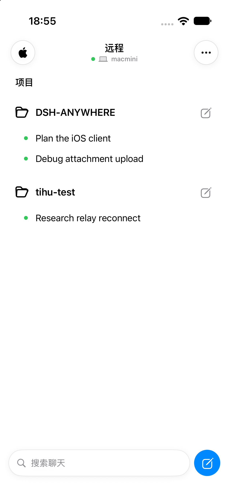
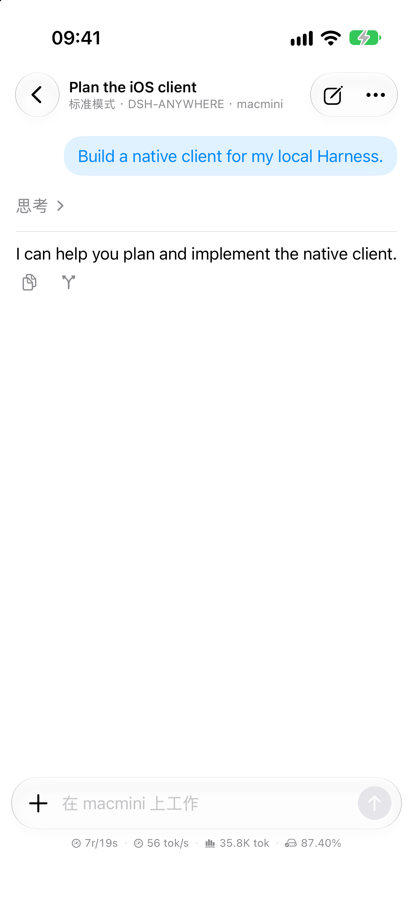
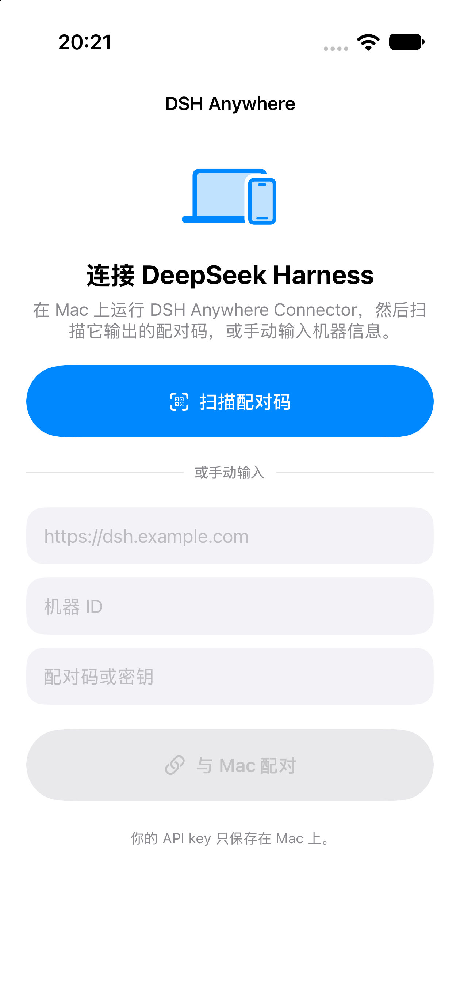

# DSH Anywhere

**Take your DeepSeek Harness sessions with you.** Browse sessions, send tasks, follow live replies, and handle questions and approvals from your iPhone.

[简体中文](README.md) · [English](README.en.md) · [Product page (available after GitHub Pages is enabled)](https://aluvien.github.io/DSH-ANYWHERE-Connector/) · [Join the iOS TestFlight](https://testflight.apple.com/join/cnkGqHtp)

DSH Anywhere consists of an iOS app, a computer-side Connector, and a Relay. The computer initiates an encrypted connection to the Relay, so you do not need to expose Harness ports or configure port forwarding. iOS 17+ is the current mobile client. Android development and public downloads are paused.

## iOS screenshots

| Sessions | Conversation and usage example | Pair a computer |
| --- | --- | --- |
|  |  |  |

## Quick start

### 1. Install the iOS app

Open the [TestFlight invitation](https://testflight.apple.com/join/cnkGqHtp) on your iPhone, join the test, and install DSH Anywhere.

### 2. Install the Connector on your computer

On the computer running DeepSeek Harness, run the command for its operating system. The installer prepares the computer-side environment, registers the computer, and starts Bridge and Connector.

**macOS**

```sh
curl -fsSL https://dsh.biaozhu.me/install | sh
```

**Linux (x64 / arm64)**

```sh
curl -fsSL https://dsh.biaozhu.me/install-linux | sh
```

**Windows 10/11 PowerShell**

```powershell
irm https://dsh.biaozhu.me/install-windows | iex
```

When installation finishes, the terminal shows a one-time pairing QR code and opens a local pairing page.

### 3. Pair your iPhone

Open DSH Anywhere, choose the QR scanner, and scan the code on your computer. Pairing codes expire after ten minutes and can only be used once. To add another computer, run its installer again.

### 4. Use the app

- Choose a computer and workspace, then open a session or create one.
- Send a task from the composer. You can attach images or files and follow live replies and tool activity.
- Answer Harness questions and approve operations when prompted.
- Use Settings to switch computers, manage paired devices, choose a language, and adjust interface options.

## How it works

```text
iPhone app ── HTTPS / WSS ──▶ Relay ◀── outbound WSS ── Connector
                                                         │
                                                         ▼
                                                 Bridge / Harness
```

| Component | Runs on | Responsibility |
| --- | --- | --- |
| iOS app | iPhone | Browse and manage sessions, send messages and attachments, handle questions and approvals |
| Relay | Project service or your server | Pair devices, authenticate credentials, and route messages |
| Connector / Bridge | macOS, Linux, or Windows computer | Connect to Relay and forward requests to the local Harness |

## Features

- Manage multiple computers and paired phones
- Organize sessions by workspace; create, open, rename, and archive sessions
- View Markdown, code blocks, tables, tool calls, and streaming output
- Handle questions, approvals, permission modes, and model selection
- Send image and file attachments
- Simplified Chinese, English, and system-language selection

## Security and scope

The project is intended for personal use and controlled testing. HTTPS/WSS protects data in transit, but the protocol is not end-to-end encrypted. Relay is part of the trust boundary and can read routed messages. It does not intentionally persist session contents. Accounts, organization permissions, and public multi-tenant isolation are not complete. Only install Connector on computers you control.

## Self-hosting Relay

See [`deploy/relay/README.md`](deploy/relay/README.md) to run your own Relay. Self-hosting requires a Linux server, a domain, a TLS certificate, Docker Engine, and Docker Compose.

## Build the iOS app

```sh
open ios/DSHAnywhere.xcodeproj
```

Select your Apple Developer Team in Xcode and install the app on an iPhone. QR pairing requires a physical device; the simulator can use manual pairing.

## Repository layout

```text
site/                     Product page and iOS screenshots
ios/DSHAnywhere/          iOS client
packages/protocol/        Shared message types and validation
packages/relay-server/    Relay service
packages/connector/       Cross-platform computer connector
packages/dsh-anywhere-plugin/ Harness Bridge
deploy/relay/             Self-hosted Relay files
scripts/                  macOS, Linux, and Windows installers
android/                  Paused Android source
```

The product page is in [`site/`](site/). Automatic GitHub Pages deployment is configured. In the repository, go to **Settings → Pages → Build and deployment → Source**, choose **GitHub Actions**, then push to `main` to publish it.

## Upgrade compatibility

The Harness parity release requires Relay `schemaRevision >= 11` (check `/health`). Upgrade Relay first, then reinstall Connector and Bridge together, then update the iOS app. Existing machine identity and phone pairings are retained.

Connector verifies the Relay schema on every connection before forwarding messages or phone operations. An older Relay produces an explicit upgrade diagnostic; messages remain buffered within the documented transport limits and reconnect after the Relay is upgraded. Bridge rejects obsolete Connectors with HTTP 426. Legacy clients that do not opt into Relay schema negotiation retain the original greeting format; this does not enable new features on old computer components.
